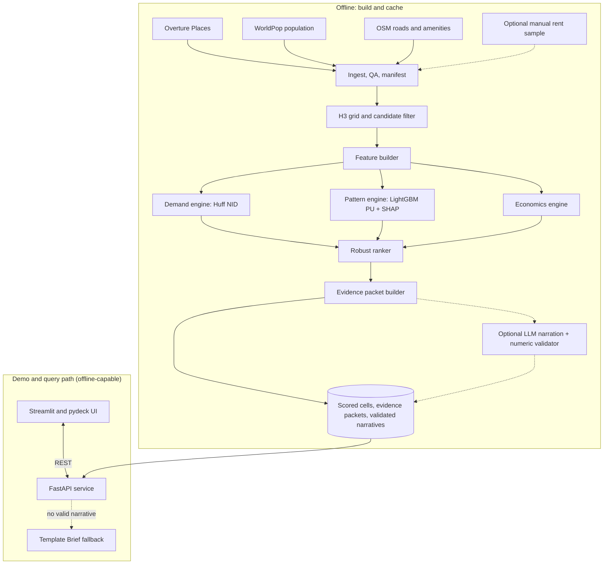

# NextWhere: Retail Expansion Intelligence Platform

**Product Requirements Document v2.5** | Problem Statement 1 | Team: teamcode | Round 1 (PRD Submission)

---

## 1. Overview

**One-line pitch.** NextWhere tells a retail chain where to open its next store by estimating how much demand a site would win from competitors, net of what it would take from the chain's own stores, and it shows the evidence behind every number.

**Why now.** Open, permissively licensed place, population and road data (Overture, WorldPop, OpenStreetMap) are now good enough to run a defensible site analysis with zero paid inputs. What is missing is a tool that shows its work: assumptions, uncertainty and evidence.

**What NextWhere does.** It scores H3 resolution 9 cells across a city and returns a ranked, explainable shortlist of where a chain should open its next store. Three analytic engines feed one ranker:

| Engine | What it does | Technique |
|---|---|---|
| Demand engine | Estimates net incremental demand (NID): demand allocated to a new store minus demand shifted from the chain's existing stores. Under fixed total demand, NID equals demand shifted from competitors. | Huff gravity model on 100 m population grids; Monte Carlo over uncertain parameters |
| Pattern engine | Learns the characteristics of locations where experienced chains operate. | LightGBM positive-unlabeled classifier, spatial block cross-validation, SHAP |
| Economics engine | Estimates operating-cost pressure and a break-even coverage ratio per site. | Hedonic rent model (ridge/GBM) when a rent sample exists; otherwise a labelled rent-proxy index; editable unit-economics parameters |

Recommendations include rank intervals (P10 to P90) and the probability of appearing in the top 10 under parameter and weight uncertainty. Each Site Brief is built from a deterministic evidence packet; any narrative is validated against that packet and unsupported numbers are rejected.

**Why it is different.**
- It ranks by *net incremental demand* (competitor-sourced demand after own-store cannibalization), not by population or a hand-weighted score.
- Every score carries a rank interval, and every sentence in a Site Brief is checked against an evidence packet.
- It keeps measured results, assumptions, targets and synthetic tests separate and labelled.

**What the numbers mean.** Public data has no store-level sales. NextWhere's demand output is therefore a relative demand index under explicit, editable assumptions, and "viability" is a relative index plus a break-even coverage ratio. It is a decision-support ranking, not a calibrated probability of commercial success. With a chain's sales data, the platform can be calibrated for absolute forecasts (FR22).

**Scope.** One retail category (pharmacy), one primary city (Pune), and a configurable transfer city (Nashik). The category is a configuration (brand aliases, category codes, Huff parameters, unit economics); a second category needs only a config and a data audit, but only pharmacy is shipped.

**Build tiers.** Tier 1 = P0 requirements (must ship). Tier 2 = P1 (ship once Tier 1 passes its release gate). Tier 3 = P2 (deferred, not part of Round 1 claims).

**3-minute demo path (offline, cached Pune data).**
1. Open the data card: sources, versions, licences, quality checks.
2. Pick a pharmacy chain; see ranked sites on the hex map and in the table.
3. Toggle the population-only baseline; see which sites move and why.
4. Open a Site Brief: capture, cannibalization, NID, drivers, risks, evidence IDs, and the validated narrative (or template).
5. Compare site #3 against site #1.
6. Open the validation page: measured results versus targets, with synthetic tests labelled separately.
7. Export the shortlist as CSV.

**Headline targets** (pre-registered goals, reported whether met or not; extended goals are in Section 9.2).

| KPI | Goal |
|---|---|
| K1: Lift@10% on held-out chain stores, spatial block CV | Beat population-only and weighted-sum baselines; point estimate at least 2.0x over random, with 95% CI. If the lower CI bound is at or below 1.0x, report as inconclusive. |
| K2: Spatial-CV ROC-AUC | At least 0.75; report actual value and uncertainty |
| K5: Top-20 overlap under 10% competitor-POI dropout | At least 70% |
| K6: Core invariant suite | 8/8 pass (I1-I6, I10, I12); stretch I7-I9, I11 reported |
| K15: Reproducibility | Fresh clone reproduces identical `metrics.json` |
| K18: Synthetic ground truth | Pass the three checks in Section 9.1 |

---

## 2. Requirement Coverage

How each element of Problem Statement 1 is addressed.

| Problem-statement requirement | How NextWhere addresses it | Where |
|---|---|---|
| Evaluate geographical and demographic information | H3 grid over the city; WorldPop population (including age structure), OSM land use and buildings | 8.1, 8.5 |
| Competitor locations | Overture POIs resolved to chains; competition features; Huff competitor weights | 8.1, 8.5, 8.6 |
| Existing store coverage | Own-store distance and count features; cannibalization term in NID | 8.5, 8.6 |
| Accessibility | Distance to arterial roads, intersection density, transit-stop distance, detour-adjusted distance in Huff; OSM network reachability (P1) | 8.5, FR04, FR17 |
| Estimated operating costs | Rent-pressure model, monthly cost and break-even coverage ratio; proxy mode always available, rent-sample model in P1 | 8.8, FR07, FR20 |
| Identify patterns | LightGBM positive-unlabeled pattern engine with spatial CV | 8.7 |
| Estimate potential customer demand | Huff demand engine with Monte Carlo intervals | 8.6 |
| Predict commercial viability | NID, coverage ratio vs break-even, and flags (relative index, not a revenue forecast) | 8.6, 8.8, 8.9 |
| Rank by suitability for expansion | Expansion Priority Score (EPS) with rank intervals and top-10 probability | 8.9 |
| AI-generated, evidence-based explanations: promising factors, risks, comparison | Site Brief from an evidence packet; SHAP drivers; risk flags; compare view; validated narration | 8.10, FR10, FR11, FR19 |
| AI must contribute meaningfully | Models produce the scores and ranks; the LLM only narrates validated evidence | 3 |
| State assumptions, data sources, limitations | Data card in the UI, assumptions register, limitations | 8.1, 10, FR14 |
| Public or realistic simulated data | Public data for the real-city results; synthetic data only for labelled tests | 8.2, 8.11 |
| Functional software | Offline demo from cached data: map, table, Briefs, validation page, CSV | 1, 6.4, 11 |

---

## 3. How AI Is Used

| Component | Technique | Input | Output | Role in the decision |
|---|---|---|---|---|
| Pattern engine | LightGBM positive-unlabeled classifier with spatial block CV, SHAP | About 30 cell features | Pattern score, SHAP drivers | 30% of EPS; drivers appear in every Brief |
| Demand engine | Huff gravity model, Monte Carlo over beta, population noise and competitor dropout | Population grid, own and competitor supply | Capture, cannibalization, NID with intervals | 40% of EPS; core signal |
| Economics engine | Hedonic regression (ridge/GBM) or labelled proxy index | Location features, unit-economics assumptions | Rent pressure, monthly cost, coverage ratio | 30% of EPS (affordability); coverage ratio is a flag and constraint |
| Robust ranker | Weight and parameter sampling | Component percentiles | Rank P10/P50/P90, top-10 probability, flags | Final ranking and fragility signal |
| Explanation pipeline | SHAP plus deterministic evidence packet; optional constrained LLM narration with numeric validation | Evidence packet | Site Brief and compare view | Explains; never scores or ranks |

The ranking comes from learned and simulated models. The pattern engine learns from observed store placement; the demand engine is a theory-driven spatial model whose parameters are sampled, not fitted, in P0. The LLM is limited to narrating a fixed evidence packet, and its output is rejected if any number or evidence ID is not in the packet.

---

## 4. Problem and Value

### 4.1 The problem

Retail chains choose store sites with spreadsheets, broker tips and gut feel. Two errors recur: (a) picking a high-population site that competitors have already saturated, and (b) picking a "good" site that mostly takes sales from the chain's own nearby store. Both can look attractive on a population map and still lose money. Choosing a site means trading off population, competition, accessibility, rent and existing coverage. Manual research does not scale beyond a handful of candidates, is hard to audit, and cannot show how sensitive a choice is to assumptions.

### 4.2 Why naive approaches fail

| Failure mode | Example | What NextWhere does instead |
|---|---|---|
| Population is not demand | A dense ward with six competing pharmacies within 400 m yields a small share per store | Huff share divides demand among stores by attractiveness and distance |
| Cannibalization is ignored | A site 350 m from the chain's own store looks attractive but may relocate existing sales | NID subtracts estimated demand shifted from the chain's own stores |
| Weighted-sum scoring has arbitrary weights | "0.4 x population - 0.3 x competitors" is hard to defend | Weights are explicit, editable and stress-tested |
| Random-split ML overstates accuracy | Nearby cells leak between train and test | Spatial block CV with a buffer |
| LLM-written rationales can invent numbers | "Catchment of 48,000 people" when the data says 31,000 | Narrative numbers are checked against an evidence packet |

### 4.3 Value model (parametric)

No market statistics are claimed. The value hypothesis is a formula an operator can fill in:

```text
Capital at risk per year = m * N * K
Expected value of NextWhere = delta_m * N * K
```

K is sunk capital per store (fit-out, deposit, opening inventory), N is stores opened per year, m is the share of openings that fail to cover their costs, and delta_m is the reduction in m attributable to better selection. K, N and m come from the operator; delta_m is measured in the pilot (Section 12.2, shadow mode), not assumed. *Illustration in abstract units:* if a rollout puts 100 units of capital into new stores and the mis-siting share falls from 20% to 15%, the avoided loss is 5 units.

A second, separately measured benefit is analyst time: Persona Meera targets a defensible top 10 in under 10 minutes (K16).

### 4.4 Goals and non-goals

| Goals | Non-goals |
|---|---|
| Rank candidate sites by NID, learned placement pattern and economics | Forecast absolute rupee revenue without client sales data |
| Quantify uncertainty and rank robustness | Live property-listing availability or lease negotiation |
| Explain recommendations with checkable evidence, risks and comparisons | Real-time footfall or traffic |
| Run reproducibly on open data | Replace human site visits; humans verify frontage and legal status |

---

## 5. Users and Journeys

### 5.1 Personas

| Persona | Role and decision | Pain today | Needs | Success criterion |
|---|---|---|---|---|
| Meera, Head of Expansion | Approves the next 10-15 store sites per year | Shortlists rely on brokers and anecdotes; cannibalization is unclear | Ranked shortlist, cannibalization estimate, board-ready explanation | Defensible top 10 in under 10 minutes |
| Arjun, Site Analyst | Builds and verifies candidate lists, visits sites | Spends days assembling competitor lists and catchment numbers | Filters, what-if, compare view, CSV export | Reduces hundreds of cells to a short list for verification |
| Sunil, Franchise Investor | Evaluates a broker-proposed site | Cannot tell a lively street from a saturated one | Pin-based result, rank among alternatives, break-even ratio, risks | Knows whether to proceed or negotiate |

These personas are product hypotheses to be tested in the pilot (Section 12.3).

### 5.2 Journeys

**J1. Shortlist the next stores (P0).** Select city, category, chain and constraints; view the top 20 sites on a hex map and in a ranked table; open a Site Brief; export the shortlist. *Acceptance:* completes in at most 3 clicks on cached data; every figure in the Brief traces to a feature or model output.

**J2. Defend a site (P0 steps 1-2, P1 step 3).** (1) Compare site #3 against site #1. (2) Review differences in demand, cannibalization, pattern fit and cost. (3) Change the rent assumption and inspect the rank change. *Acceptance:* steps 1-2 use only computed values and evidence IDs; step 3 re-ranks from cached component scores with p95 at most 2 s (FR15).

**J3. Evaluate a proposed site (P0).** Drop a pin or paste coordinates; it snaps to an H3 cell. View percentile, NID interval, cannibalization estimate, coverage ratio and risks. *Acceptance:* result in at most 2 s on cached data; non-candidates (water, zero-population cells) receive a reason.

**J4. Build a diversified rollout (P1).** Select k sites by greedy marginal NID; report the joint NID of the selected set next to the joint NID of the top-k individual sites. Greedy selection has no optimality guarantee.

**J5. Upgrade with sales data (P2).** Upload `store_sales.csv`, calibrate demand parameters, compare before/after errors on held-out stores.

---

## 6. Functional Requirements

Priority maps to build tier: P0 = Tier 1, P1 = Tier 2, P2 = Tier 3.

### 6.1 P0: Must-have (Tier 1)

| ID | Requirement | Acceptance criterion |
|---|---|---|
| FR01 | Versioned data ingestion and cache | `make data CITY=pune` builds a local cache; manifest records sources, versions, retrieval date, row counts and SHA-256. Demo runs offline. |
| FR02 | H3 grid and candidate filter | H3 resolution 9 cells over the city boundary; excluded cells carry reason codes. At least 95% of candidate cells meet the configurable minimum of 50 residents. |
| FR03 | Chain and competitor resolution | Brand aliases plus fuzzy matching (token ratio at least 90) and confidence filter (default at least 0.7). Manual audit of 50 random POIs: at least 90% correct labels (K9). |
| FR04 | Leakage-safe feature builder | About 30 features, including accessibility features (arterial-road distance, intersection density, transit-stop distance); features for a cell exclude that cell's own store. Deleting the focal store leaves that cell's features unchanged. |
| FR05 | Demand engine | Capture, cannibalization, NID and cannibalization percentage with Monte Carlo intervals. Store cells are scored counterfactually with the focal store removed from supply. Core invariants I1-I6, I10, I12 pass 8/8. |
| FR06 | Pattern engine | LightGBM positive-unlabeled classifier, SHAP values and spatial block CV report. SHAP additivity error below 1e-6. |
| FR07 | Economics engine | Rent-pressure estimate, monthly cost and break-even coverage ratio; parameters editable. Works without a rent sample using a labelled proxy index (Section 8.8). |
| FR08 | Robust ranking | Output includes `rank_p10`, `rank_p50`, `rank_p90`, `top10_prob` and `flags[]` (including the model-disagreement flag). Partial-ranking rules in Section 8.9 apply when a component is unavailable. |
| FR09 | Constraint filters | Minimum distance to own store, maximum rent index, minimum coverage ratio, polygon of interest; excluded sites include reasons. |
| FR10 | Site Brief | Evidence packet plus a brief covering verdict, top drivers, risks and comparison. Every narrative number is in the packet; deterministic template is always available. |
| FR11 | Compare view | Contrastive component deltas and top SHAP deltas; each difference has a value and evidence ID. |
| FR12 | Map UI | H3 layer, ranked table, population-only baseline toggle, Brief, pin lookup and CSV export. Loads the cached city in at most 3 s. |
| FR13 | Validation report | `make validate` produces `metrics.json` and a UI page for baselines, CIs, robustness, invariants, synthetic ground-truth tests and component correlations. |
| FR14 | Data card and assumptions panel | Sources, versions, licences, assumptions and limitations visible in the UI and consistent with the manifest. |

### 6.2 P1: Should-have (Tier 2)

| ID | Requirement |
|---|---|
| FR15 | What-if simulator. First release: edit rent or unit-economics assumptions and re-rank from cached component scores. Later: add competitor/own-store pins with local Huff recomputation. An LLM may parse commands into validated change sets but never decides scores. |
| FR16 | Greedy marginal-NID portfolio selection, with joint NID reported against top-k individual sites. |
| FR17 | Network accessibility from the OSM network (for example walk-reachable population within 10 minutes); compare with the P0 detour approximation or label the approximation. |
| FR18 | Cross-city transfer test: train on Pune, evaluate on Nashik or the documented fallback city. |
| FR19 | Constrained LLM narration of Site Briefs: narratives pre-generated offline for the top-ranked sites, validated against the evidence packet, cached with the demo data; live generation optional. Template fallback on any failure. |
| FR20 | Rent model anchored on at least 30 manually recorded public asking rents; report spatial-CV R-squared and degrade the economics weight if below 0.30. |
| FR21 | Temporal backtest, only if an initial data check confirms adequate OSM history. |

### 6.3 P2: Nice-to-have (Tier 3)

| ID | Requirement |
|---|---|
| FR22 | Sales-data upgrade: calibrate demand parameters and add a supervised model. |
| FR23 | Category plug-ins via YAML. |
| FR24 | Locally varying distance decay. |
| FR25 | Conformal prediction intervals for the pattern engine. |
| FR26 | Equity overlay for underserved areas. |
| FR27 | React + MapLibre/deck.gl front end and PDF export. |

### 6.4 MVP outcome and release boundaries

**MVP objective.** Enable a retail expansion analyst to evaluate candidate locations using documented geospatial data, compare a demand-based ranking with a population-only baseline, and understand the drivers and limitations behind a recommendation.

**Mandatory end-to-end workflow:**
1. Load cached, documented primary-city data and display the data card.
2. Generate candidate locations and show exclusion reasons.
3. Calculate capture, cannibalization and NID; run the pattern and economics engines.
4. Display a ranked shortlist on a map and in a table.
5. Compare the NextWhere ranking with population-only scoring on the same candidate population.
6. Open a Site Brief that explains the ranking using stored evidence.
7. Display data-quality checks, validation results, assumptions and unavailable metrics.
8. Export the shortlist and complete the workflow offline.

**Component quality gates.** If a component fails its quality gate or lacks data (for example the pattern model cannot be evaluated on the available POIs), it is labelled unavailable or degraded and the ranking falls back to a labelled partial ranking (Section 8.9). Results are never silently substituted or fabricated.

**May be precomputed or simplified:** full-city scores and top-site evidence packets; a single pattern model without ensembling; fewer Monte Carlo draws (disclosed); a numeric comparison table instead of narrated comparison; live ingestion; transfer-city analysis.

**Never simplified away:** data provenance, focal-store removal in counterfactual evaluation, identical candidate populations for baseline comparisons, separation of real and synthetic results, visible score-availability warnings, and the deterministic Site Brief fallback.

**Out of scope for the initial MVP:** cross-city generalization, portfolio optimization, advanced natural-language controls, calibrated revenue prediction.

**Release gate.** The MVP is demo-ready only when the mandatory workflow runs end to end from a fresh documented setup, core demand tests pass, and every displayed metric is labelled measured, target, or not evaluated with a reason.

### 6.5 Non-functional requirements

| Area | Requirement |
|---|---|
| Performance | Cached query p95 at most 500 ms; what-if p95 at most 2 s; full-city scan at most 60 s on an 8-core, 16 GB laptop (targets to benchmark) |
| Reproducibility | Pinned dependencies, fixed seeds, Docker image, data manifest with hashes |
| Reliability | Offline demo from cache; LLM failure falls back to the template |
| Data governance | No personal data; population only in aggregated cells; licence attribution in UI |
| Cost | Zero required paid services or API calls |
| Security | API keys via environment variables; none committed to the repository |
| Transparency | Scores expose their inputs, parameters and data versions |

---

## 7. Architecture

### 7.1 Data flow



### 7.2 Components

| Component | Responsibility | Suggested technology |
|---|---|---|
| Ingest and QA | Fetch, filter, deduplicate, write versioned local data | DuckDB, rasterio, OSMnx |
| Grid | H3 cells, population aggregation, reason-coded exclusions | h3-py, geopandas, shapely |
| Features | Leave-focal-out features and neighbourhood summaries | NumPy, pandas |
| Demand engine | Huff NID and uncertainty simulation | NumPy |
| Pattern engine | Positive-unlabeled classifier, CV, SHAP | LightGBM, scikit-learn, SHAP |
| Economics engine | Rent model or proxy, monthly costs, coverage ratio | scikit-learn |
| Ranker | Percentile fusion, weight sampling, rank intervals, flags | NumPy |
| Explanation pipeline | Evidence packet, optional narration, validation, fallback | Pydantic and an optional LLM adapter |
| API and UI | REST service and map/table/Brief interface | FastAPI, Streamlit, pydeck |

### 7.3 API contract

| Endpoint | Input | Output |
|---|---|---|
| `GET /v1/candidates` | City, category, chain, k, weights, constraints | Ranked sites, EPS, rank interval, top-10 probability, NID interval, cannibalization, coverage ratio, flags |
| `GET /v1/sites/{h3}/brief` | H3 ID, optional comparison | Evidence packet and validated or template narrative |
| `GET /v1/compare` | Site A and B | Numeric component deltas and evidence |
| `POST /v1/whatif` (P1) | H3 ID or assumption set, validated change set | Score and rank changes |
| `GET /v1/validation` | None | `metrics.json` |
| `GET /v1/datacard` | None | Sources, versions, licences, assumptions |

### 7.4 Failure handling

| Failure | Behaviour |
|---|---|
| Live data source unavailable | Use cached data; manifest shows data date |
| LLM unavailable or fails validation | Return deterministic template Brief |
| Rent model R-squared below 0.30 | Show rent as a unitless pressure index and reduce economics weight |
| Sparse POIs nearby | Add low-data-confidence flag and widen uncertainty where supported |
| Data feasibility gate fails | Try the category/city fallback; if real data remains inadequate, do not present synthetic results as real-city evidence |

---

## 8. Data and Model Design

### 8.1 Data sources and licensing

| Source | Use | Licence / risk |
|---|---|---|
| Overture Maps Places | Competitors, stores, amenities | CDLA-Permissive 2.0; cache a pinned release and audit POI coverage |
| WorldPop constrained population | Residential population and age/sex structure | CC BY 4.0; modelled population; uncertainty and attribution required |
| OpenStreetMap | Roads, land use, transit, buildings | ODbL; completeness varies |
| Manual rent sample (P1) | Anchor the rent model | Manually collected public asking rents; no scraping |
| Unit-economics defaults | Break-even calculations | Explicit assumptions, to be replaced with operator data |

### 8.2 Day-0 feasibility gate and fallback

Before model development, run `make audit` and record counts and confidence distributions for Pune and the transfer city.

**Preferred gate:**
- At least 150 pharmacy POIs in Pune.
- At least 100 pooled branded pharmacy stores in Pune, including at least 15 from the selected demo chain.
- At least 40 pooled branded pharmacy stores in the transfer city.
- Median confidence of the relevant Overture POIs at least 0.7.

**Fallback sequence:**
1. If the pharmacy gate fails in Pune, audit cafe and QSR POIs with the same criteria and select the category with the strongest real-data coverage.
2. If the transfer-city gate fails, report the transfer test as unavailable rather than lowering the threshold.
3. If no category meets the primary-city gate, build a clearly labelled **synthetic-only prototype**. Synthetic results are never described as real-city performance or counted as evidence for real-world Lift@10%.
4. Record the chosen path, counts, source versions and any unmet gate in the validation report and demo.

The demo chain is the branded chain with the most high-confidence POIs in the audit; no brand is assumed in advance.

### 8.3 Data schema (cached tables)

| Table | Key fields |
|---|---|
| `poi` | `poi_id`, `name`, `category`, `brand_id` (resolved), `lat`, `lon`, `overture_confidence`, `match_score`, `is_own` (for selected chain), `is_branded_pool` |
| `cell` | `h3_id`, `population`, `age60_share`, `is_candidate`, `exclusion_reason`, `has_own_store`, `has_pool_store` |
| `features` | `h3_id` plus about 30 columns (Section 8.5), computed leave-focal-out |
| `scores` | `h3_id`, `nid_p10/p50/p90`, `capture_p50`, `cannib_pct_p50`, `pattern_score`, `rent_pressure`, `coverage_ratio_p50`, `eps`, `rank_p10/p50/p90`, `top10_prob`, `flags`, `rent_mode` (`model` or `proxy`) |
| `evidence` | `evidence_id`, `h3_id`, `type`, `value`, `unit`, `source_table`, `data_version` |
| `manifest` | source, version, retrieval date, row count, SHA-256 |

**Synthetic data** (labelled tests only): a generator places stores and demand cells with known Huff parameters, so recovered NID and ranks can be compared with truth (K18).

### 8.4 Real-world anchors (Day-0 deliverables)

Checkable facts computed from the cache, never quoted from memory:

1. **Store-locator reconciliation.** For the demo chain, compare the number of Pune stores on its official locator with the number in the cache. Report coverage percentage and mismatches (feeds FR03, K9 and the POI coverage audit).
2. **Worked example on real places.** Pick two real Pune neighbourhoods, one dense and saturated, one moderate and under-served. Show population, competitors within 400 m, distance to the nearest own store, and how the population-only rank differs from the NextWhere rank.
3. **Retrospective hide-and-rank.** Where opening dates for recent stores can be verified, hide those stores and report their ranks; otherwise mark "not evaluated" and rely on spatial-CV Lift@10%.

Any external statistic used in the pitch carries its source, URL and retrieval date, or is omitted.

### 8.5 Feature groups

About 30 candidate features; latitude and longitude are not predictors. Count features are converted to within-city percentiles where suitable.

| Group | Examples |
|---|---|
| Demand | Population within radii; age 60+ share; residential building density |
| Footfall generators | Distance-weighted counts of hospitals, clinics, schools, transit stops, markets, offices |
| Accessibility | Distance to arterial roads; intersection density; distance to nearest transit stop; walk-reachable population (P1, FR17) |
| Competition | Competitor counts, nearest competitor, brand diversity; focal store excluded |
| Own coverage | Distance to nearest own store; own-store count within 1 km |
| Cost and context | Rent-pressure index, commercial density, affluence proxy |

### 8.6 Demand engine: Huff net incremental demand

For demand cell *j*, let P_j be population and w_ij = A_i f(d_ij) the attractiveness-distance weight for store *i*. Default distance function:

```text
f(d) = max(d, 0.2 km)^(-beta)
share_ij = w_ij / SUM_k(w_kj)

Demand_j = lambda * P_j
Sales_i  = SUM_j [ Demand_j * share_ij ]

Capture_c          = Sales_c(after adding candidate c)
Cannibalization_c  = SUM over own stores i of (Sales_i(before) - Sales_i(after))
NID_c              = Capture_c - Cannibalization_c
Cannibalization %  = Cannibalization_c / Capture_c
```

Under fixed total demand, NID equals the volume shifted away from competitors.

**Single-cell form.** For one demand cell, let O be the existing own-store weight, C the competitor weight, D = O + C, and x the candidate weight. Capture is proportional to x/(D+x); the share of capture that replaces own-store demand is O/D; so NID is proportional to [x/(D+x)] * [C/D]. With no competitors and at least one own store, NID is zero. Adding a competitor can raise NID by lowering the own-store share of capture, but it cannot raise Capture.

**Worked example** (one demand cell per site, beta = 2 for easy arithmetic, lambda = 1, A = 1; real runs sum over all cells with beta sampled around 1.5). Weight is 1/d^2 with d in km.

| Site | Population | Own stores | Competitors | Candidate weight x | Capture | Cannibalization | NID |
|---|---|---|---|---|---|---|---|
| A | 1,000 | one at 1.0 km (O = 1) | one at 0.5 km (C = 4) | 4 (0.5 km) | 4/9 x 1000 = 444.4 | 1/5 x 1000 - 1/9 x 1000 = 88.9 (20.0%) | 355.6 |
| B | 1,000 | none | four at 0.5 km (C = 16) | 4 (0.5 km) | 4/20 x 1000 = 200.0 | 0 | 200.0 |
| C | 600 | none | one at 2.0 km (C = 0.25) | 4 (0.5 km) | 4/4.25 x 600 = 564.7 | 0 | 564.7 |

A population-only ranking puts A and B (1,000 residents) above C (600). NID ranks C > A > B: C is under-served, and B is saturated. A's NID equals the demand shifted from its competitor (444.4 - 88.9 = 355.6), as the fixed-demand identity requires.

**Demand scaling.** `lambda` is the assumed monthly category transactions per resident. It is uncalibrated in P0, and its value and units appear in the assumptions panel. It scales demand uniformly, so it does not change EPS ranking, but it does change absolute break-even flags and coverage ratios. A sensitivity run over a documented plausible range is part of validation.

**Parameters.** Default A_i = 1 unless overridden. Monte Carlo draws sample beta from Triangular(1.0, 1.5, 2.5), population multipliers from lognormal noise, and competitor dropout from U(0, 0.2). These are assumptions, not calibrated distributions.

**Distance.** P0 uses haversine distance times 1.3 as a detour approximation. A sensitivity run varies the factor from 1.2 to 1.5 and reports the effect on top-20 overlap. Network distance is P1 (FR17).

### 8.7 Pattern engine and evaluation

**Labels.** Positive cells contain at least one high-confidence branded store of the category; other candidate cells are unlabeled, not confirmed negatives. Training negatives exclude cells within two H3 rings of a positive.

**Model.** LightGBM positive-unlabeled classifier. Monotonic constraints only where domain logic is unambiguous; competitor density is not constrained.

**Evaluation protocol.**
- Partition the city into H3 resolution 6 parent-cell blocks; assign blocks to spatial folds and repeat with shifted assignments.
- For each fold, hold out positive store cells in the test blocks; remove training cells in the test blocks and a 1 km buffer around test positives.
- Fit preprocessing, negative sampling and the model on training data only. Held-out labels are never used to select features, tune parameters or generate negatives.
- Rank the same eligible candidate-cell population for every method within the test area; state the denominator and number of held-out positives in `metrics.json`.
- **Lift@10%** = fraction of held-out positive store cells ranked in the top 10% of eligible test cells, divided by 0.10.
- Bootstrap by resampling spatial blocks, not individual stores. Report block and positive counts; if blocks are too few, label the interval unstable. Report fold-assignment variability separately.

**Baselines:** random, population-only, a weighted-sum heuristic, and counterfactual Huff NID. The hybrid combines NID and pattern percentiles; economics is excluded from this evaluation because store labels do not validate rent.

**Counterfactual scoring.** When an existing store cell is evaluated as a positive, the focal store is removed from the supply set before features and NID are computed, so the store is not penalised for demand it already captures.

**Explainability.** SHAP TreeExplainer. Audit whether removing the top three SHAP features hurts held-out performance more than removing three random features.

### 8.8 Economics engine

```text
rent_pressure_c  = hedonic_model(location features)
monthly_cost_c   = rent_psf_c * store_area + fixed_cost
breakeven_tx_c   = monthly_cost_c / gross_margin_per_transaction
coverage_ratio_c = NID_c / breakeven_tx_c
```

Store area, fixed cost, transaction value, gross margin and `lambda` are editable and shown with results. Coverage ratio is a reported viability metric, constraint and risk flag; it is not an EPS term because NID already carries the demand signal.

**Proxy mode (always available).** Without a rent sample, a unitless rent-pressure index is built from OSM commercial density and centrality and labelled "rent proxy". Monthly cost, break-even and coverage ratio then appear only under the editable unit-economics assumptions and carry a "rent proxy" flag.

**Model mode (P1, FR20).** With at least 30 manually recorded public asking rents, a ridge/GBM hedonic model is fit. If spatial-CV R-squared is below 0.30, rent is shown only as a unitless pressure index and the economics weight is reduced.

### 8.9 Robust ranking

```text
EPS_c = w_D * pct(NID_c) + w_P * pct(PatternScore_c) + w_E * pct(Affordability_c)

Affordability_c = -monthly_cost_c
Default weights (w_D, w_P, w_E) = (0.40, 0.30, 0.30)
```

If the rent model degrades, set w_E = 0.15 and rescale the others proportionally. Coverage ratio stays out of EPS to avoid counting demand twice.

**Score availability rules:**
- Standard EPS is computed only when all components are available and pass their quality checks.
- If a component is unavailable, it is never treated as zero. The system shows a clearly labelled **partial ranking** from available components with proportionally renormalised weights, records the active components and effective weights in the evidence packet, and displays a warning that the result is not equivalent to full EPS.
- If a component is unreliable, the documented degradation rule applies and the reason is shown.
- The Site Brief states whether the result is standard EPS or partial ranking and lists unavailable or degraded components.

Rank intervals and top-10 probability come from parameter and weight draws (default 100 draws; fewer is allowed if disclosed). Flags:

| Flag | Rule |
|---|---|
| High cannibalization | Cannibalization percentage above 35% |
| Fragile rank | Rank interval spans more than 25 places |
| Model disagreement | Demand and pattern percentiles differ by more than 30 points |
| Low data confidence | Sparse high-confidence POIs or a population-data caveat |
| Saturated | Competitor count within 300 m above the city's 90th percentile |
| Below break-even | Coverage ratio below 1.0 at P50 |

### 8.10 Explanation pipeline

1. Build a deterministic JSON evidence packet with evidence IDs, values, SHAP drivers, Huff components, flags, rank interval and comparison deltas.
2. Narrate the packet with a template (always) or an LLM using a fixed output schema (FR19). Narratives are pre-generated offline and cached; the demo needs no live model.
3. Validate every numeric token and evidence ID against the packet. Retry once; on failure or unavailability, use the template.
4. Scoring and ranking stay outside the LLM.

A format example of a Site Brief is in Appendix B.

### 8.11 Validation and sanity tests

| Test | Method |
|---|---|
| Baseline comparison | Lift@10%, PR-AUC, ROC-AUC with spatial block CV and buffer |
| Cross-city transfer (P1) | Train on the primary city, evaluate on the transfer city if its data gate passes |
| Noise robustness | Population noise, POI jitter, competitor dropout, detour factor 1.2-1.5 |
| SHAP deletion | Top-feature deletion versus random-feature deletion |
| POI coverage audit | Selected chain counts versus official store locators |
| Component correlation | Pairwise Spearman among EPS components |
| Synthetic ground truth | Simulate known Huff parameters and sales; reported separately from real-city evaluation |
| Invariant suite | I1-I12 in Appendix A; I1-I6, I10, I12 release-gating |

### 8.12 Zero-cost build and demo stack

The demo requires no paid services, API keys or live LLM. It uses open data, open-source libraries, local compute and cached inputs, with briefs pre-generated. Any optional free hosting or model service must be verified before use; the offline demo is the reliable path.

---

## 9. Success Metrics

### 9.1 Core goals (reported in every release)

| ID | Metric | Pre-registered goal | Measurement |
|---|---|---|---|
| K1 | Lift@10% on held-out stores | Hybrid beats population-only and weighted-sum baselines; point estimate at least 2.0x over random; lower 95% CI bound at or below 1.0x is inconclusive | `make validate`; spatial block CV |
| K2 | Spatial-CV ROC-AUC | At least 0.75; report actual value and uncertainty | `make validate` |
| K5 | Top-20 overlap under 10% competitor dropout | At least 70% | Dropout test |
| K6 | Core invariant suite | 8/8 pass (I1-I6, I10, I12); stretch I7-I9, I11 reported | Automated tests |
| K15 | Reproducibility | Fresh clone reproduces identical `metrics.json` using documented commands | Fresh-clone test |
| K18 | Synthetic ground truth | True-beta NID matches simulator to 1e-9; median-rank Spearman at least 0.85; at least 80% of true top-20 sites fall within rank intervals | `make validate`; reported separately |

### 9.2 Extended goals (report if implemented; otherwise "not evaluated" with reason)

| ID | Metric | Goal |
|---|---|---|
| K3 | Cross-city transfer Lift@10% | At least 1.8x, only if the transfer data gate passes |
| K4 | Rank stability under noise | Spearman at least 0.90 |
| K7 | SHAP additivity and deletion | Additivity error below 1e-6; deletion test reported |
| K8 | Narrative numeric faithfulness | 100% after validation; first-pass rate at least 90% (applies when FR19 ships; template Briefs are faithful by construction) |
| K9 | Entity-resolution accuracy | At least 90% on the 50-POI audit |
| K10 | Rent-model spatial-CV R-squared | Reported; below 0.30 triggers the degrade rule (needs rent sample) |
| K11 | Cached `/candidates` p95 | At most 500 ms |
| K12 | Full-city scan with 100 draws | At most 60 s, if benchmarked |
| K13 | What-if p95 | At most 2 s when implemented |
| K14 | Brief narrative p95 | At most 6 s for optional live LLM; at most 200 ms for template |
| K16 | Usability walkthrough | At least 4 of 5 first-time users export a top 10 in at most 3 minutes |
| K17 | Infrastructure cost | Rs 0 in required services and paid API calls |
| K19 | Component independence | Report pairwise Spearman; flag absolute correlation above 0.7 |

### 9.3 Pilot outcome metrics (future)

Time for an analyst to reach a defensible top 10; share of historical openings ranked in the top 10% when held out; share of shortlisted sites that pass field verification; cannibalization-estimate error once operator sales data is available.

### 9.4 Metric status and reporting rules

Every reported metric is labelled **Target** (pre-registered, not yet measured), **Measured** (documented dataset and procedure), **Not evaluated** (with reason) or **Future pilot** (needs operator data, user research or field validation). Measured metrics include dataset and version, procedure, sample size and denominator, actual value, and uncertainty where defensible; if the sample is too small or spatially dependent for a reliable interval, the report says so. Synthetic results are reported separately and never presented as real-city performance. Missed targets are reported with their measured value and limitations.

---

## 10. Assumptions, Limitations and Risks

### 10.1 Key assumptions

| ID | Assumption |
|---|---|
| A-01 | Existing branded stores are an imperfect proxy for locations chains consider suitable. |
| A-02 | Sunk capital must be supplied by an operator before external use. |
| A-03 to A-06 | Store area, fixed cost, transaction value and gross margin are editable assumptions. |
| A-07 | P0 approximates network distance as 1.3 times straight-line distance. |
| A-08 | Total category demand is fixed; no induced demand. |
| A-09 | Store attractiveness is equal unless the user supplies a floor-area or brand-strength override. |
| A-10 | Overture confidence of at least 0.7 is a default quality filter, not proof that a place is operating. |
| A-11 | Pattern positives pool branded chains; the selected chain defines the own-store set for demand calculations. |
| A-12 | `lambda` is an uncalibrated monthly demand-scaling assumption unless an operator supplies and validates it. |

### 10.2 Limitations

- Public data has no ground-truth sales, so outputs are relative and assumption-dependent.
- Revealed-preference bias: the pattern model inherits existing chains' choices and blind spots.
- POI and OSM completeness varies by city.
- WorldPop estimates residential, not daytime, population.
- No property-listing data; the tool cannot confirm that a unit is available or leasable.
- NID measures demand shifted from competitors under fixed demand; it excludes induced demand and brand effects.
- Cross-city evidence is limited to cities that pass the data gate.
- The LLM only narrates validated evidence; it does not score or rank.
- Synthetic results demonstrate pipeline behaviour only, not real-world performance.

### 10.3 Key risks

| Risk | Mitigation |
|---|---|
| Overture POI coverage too thin for pharmacy in Pune | Day-0 gate and category fallback (8.2) |
| Spatial CV has few independent blocks, so intervals are wide | Block bootstrap; label unstable intervals; report K1 as inconclusive if so |
| 48-hour scope too large | Tiering, precomputation and the release gate (11.1) |
| Reviewers doubt demand parameters | Monte Carlo over beta, `lambda` sensitivity, synthetic recovery test |
| LLM narrative invents numbers | Numeric validator and template fallback |

---

## 11. Delivery Plan

Assumes a 3-4 person team and a 48-hour build window after Round 1.

### 11.1 Milestones and gates

| Hours | Milestone | Gate |
|---|---|---|
| 0-6 | Repository, environment, data audit, city/category choice | Gate results and fallback decision recorded |
| 6-16 | Grid, candidate filter, feature builder, Huff calculation | Core calculation tests pass |
| 16-26 | Pattern model, economics proxy, baseline evaluation | Actual metrics reported; no target claimed without evidence |
| 26-34 | Ranker, cached outputs, API | Shortlist served from cache |
| 34-42 | Evidence packets, template Brief, map and validation UI | End-to-end offline demo (Tier 1 complete) |
| 42-48 | Freeze, fresh-clone test, README, demo script | Reproducible demo and explicit limitations |

Tier 2 items (what-if, narration, rent sample, network reachability) start only after the 34-42 gate passes, in this order: rent what-if, validated narration, rent sample, network reachability.

### 11.2 Suggested ownership (4 people; merge roles if 3)

| Role | Owns |
|---|---|
| Data and grid | Ingestion, manifest, audit and anchors (8.4), H3 grid, entity resolution, features |
| Demand and tests | Huff engine, counterfactual scoring, invariants, synthetic test |
| Modelling and evaluation | Pattern model, spatial CV, baselines, economics, ranker, `make validate` |
| Product and UI | API, map and table, Site Brief and validator, data card, demo script |

---

## 12. Differentiation and Pilot

### 12.1 Differentiation

| Typical approach | NextWhere |
|---|---|
| Population and competitor weighted sum | Huff-based demand allocation with explicit own-store cannibalization |
| One score per site | Rank intervals and sensitivity to assumptions |
| Random train/test split | Spatial block evaluation with buffer |
| LLM-written rationale | Evidence packet, numeric validation, deterministic fallback |
| Single scoring method | Theory-driven demand model cross-checked against observed store placement |
| Unqualified performance claims | Pre-registered goals, reported results, and separation of synthetic from real-city evidence |

The differentiating capability is the **auditable evaluation and explanation pipeline**: scores, assumptions, data versions and evidence are inspectable and reproducible.

### 12.2 Alternatives and pilot

Market comparisons here are hypotheses to test in the pilot, not verified claims.

| Alternative | Typical strength | Gap NextWhere targets |
|---|---|---|
| Broker tips and spreadsheets | Local knowledge, speed | No audit trail; no cannibalization or sensitivity analysis |
| General location-analytics suites | Rich maps and demographics | Mostly population and competitor counts; demand allocation needs analyst setup; licence cost |
| In-house data-science models | Tuned to the chain's sales | Needs sales data and a data team; out of reach for small chains and franchisees |
| Footfall and mobility vendors | Observed movement | Paid, variable coverage, not open or reproducible |

**Potential buyers:** regional chains (Head of Expansion or CFO), franchise investors (individual operators), and franchisors and distributors (network planning teams). Possible models include a per-city subscription, per-report tier, or calibration services with chain data; willingness to pay must be validated.

**Pilot plan:**
1. **Retrospective audit:** hide historical openings and measure their ranks.
2. **Shadow mode:** compare the shortlist with the expansion team's own and field-check disagreements; this measures delta_m (Section 4.3).
3. **Calibration:** if sales data is provided, calibrate demand parameters and report before/after errors.

### 12.3 User validation plan

Seek feedback from retail expansion professionals, pharmacy operators or franchise investors. Test whether users can interpret the shortlist and tell an estimate from a verified outcome; explain capture, cannibalization and NID; explain why the ranking differs from population-only scoring; identify data gaps before acting; and decide whether the Brief helps prioritise field verification. Record participant numbers and types, tasks, confusion, feedback and resulting changes. No user research is claimed until sessions are completed.

---

## Appendix A. Invariants

Property tests with tolerance 1e-9 unless stated. Release-gating: I1-I6, I10, I12. Stretch (reported if implemented): I7-I9, I11.

1. Adding a competitor within a candidate's catchment never raises Capture.
2. With no own stores in the catchment, NID equals Capture, and adding a competitor never raises NID.
3. Doubling population in any subset of demand cells never lowers Capture or NID.
4. Cannibalization percentage equals the capture-weighted pre-existing own share.
5. A candidate at least 5 km from every own store has cannibalization below 10% under the specified test layout.
6. Swapping own and competitor labels leaves Capture unchanged and changes the cannibalization term and NID.
7. Removing all competitors maximises Capture; where own stores are present in the catchment, NID goes to zero.
8. Scaling `lambda` leaves EPS ranking unchanged, while absolute break-even flags may change.
9. Ranking is invariant to cell-ID order.
10. The same seed produces identical output.
11. Adding an own store never lowers a candidate's cannibalization percentage.
12. Demand shares sum to one before and after adding a candidate.

## Appendix B. Site Brief format example

*Format illustration only. All values are placeholders to show layout and evidence linking; they are not results.*

> **Site Brief: cell `<h3_id>` (Pune, pharmacy, chain `<chain>`)**
> **Verdict:** Shortlist for field verification. Standard EPS, all components available. Rent mode: proxy.
> **Rank:** median 3 (P10-P90: 2-9); top-10 probability 0.86 `[E-RANK-01]`
> **Demand:** capture 1,240 units, cannibalization 18% (223 units), NID 1,017 units (P10-P90: 820-1,190) `[E-CAP-01, E-CAN-01, E-NID-01]`
> **Why it ranks high:** low competitor density within 400 m (percentile 22); 60+ population share above the city median; high pattern fit driven by hospital proximity and arterial access `[E-FEAT-04, E-SHAP-01, E-SHAP-02]`
> **Risks:** nearest own store 640 m away (High cannibalization flag not raised, but watch); rent shown as proxy only `[E-OWN-01, E-FLAG-02]`
> **Compared with site #1:** 11 percentile points lower on demand, 9 points higher on affordability `[E-CMP-01]`
> **Data:** Overture release `<version>`, WorldPop `<version>`, OSM extract `<date>`.

Evidence packet excerpt (the narrative may use only values present here):

```json
{
  "h3_id": "<h3_id>",
  "eps_mode": "standard",
  "evidence": [
    {"id": "E-NID-01", "type": "nid", "p10": 820, "p50": 1017, "p90": 1190, "unit": "demand_units", "version": "<run_id>"},
    {"id": "E-CAN-01", "type": "cannibalization_pct", "value": 18, "unit": "percent", "version": "<run_id>"}
  ],
  "flags": ["rent_proxy"]
}
```

## Appendix C. Core requirement traceability

| User need | Requirement | Acceptance test | Success measure |
|---|---|---|---|
| Find promising candidate locations | FR02, FR05, FR08, FR12 | Reproducible shortlist from the documented dataset | Candidate coverage and reproducibility |
| Understand own-store cannibalization | FR05 | Unit tests verify capture, cannibalization and NID for defined scenarios | Invariant test results |
| Understand why a site ranks highly | FR06, FR10, FR11, FR19 | Every displayed figure traces to the evidence packet; missing components are disclosed | Numeric faithfulness and evidence coverage |
| Compare with a simple alternative | FR12, FR13 and Section 6.4 | Both rankings use the same eligible candidate population and evaluation split | Lift@10% and ranking comparison |
| Understand data quality and limitations | FR14 | Data card, assumptions and quality warnings match the manifest | Data audit results and disclosure checks |
| Reproduce the evaluation | FR01, FR13 | Documented commands reproduce validation outputs in a clean environment | Reproducibility test (K15) |

This table defines the intended link between requirements and tests; it does not imply any test has passed.

## Appendix D. Glossary

- **Candidate cell:** an H3 cell that passes the geographic and population filters and is eligible for scoring.
- **Counterfactual scoring:** scoring a cell containing an existing store as if that focal store were removed from the supply set.
- **EPS (Expansion Priority Score):** weighted combination of demand, pattern-fit and affordability percentiles used to rank candidate cells.
- **Huff model:** gravity model that splits each demand cell's demand among stores in proportion to attractiveness and distance decay.
- **NID (Net Incremental Demand):** candidate capture minus estimated demand shifted from the chain's own stores; under fixed demand, equals demand shifted from competitors.
- **PU (positive-unlabeled):** learning setup with known positives and unlabeled examples that are not assumed to be true negatives.

## Appendix E. Changes in v2.5

- Renamed the product from Nextware to NextWhere.
- Moved requirement coverage to Section 2 (in the problem statement's wording) and added Section 3, "How AI Is Used".
- Resolved tier conflicts: Tier 1 now equals the P0 table (pattern engine, SHAP, Monte Carlo ranking, economics proxy and compare view are core); "conditional" labelling replaced by component quality gates and partial-ranking rules.
- Added FR19 as constrained LLM narration (pre-generated, validated, cached). The former FR19 model-disagreement flag is merged into FR08.
- Split J2 into P0 (compare) and P1 (rent what-if); FR15 first release is a cached-component re-rank.
- Strengthened accessibility (transit distance in P0, network reachability in P1) and operating costs (rent-sample model in P1).
- Added a data schema, a worked Huff example with arithmetic, a Site Brief format example and a risk table.
- Reduced headline KPIs to 6; K8 and K9 moved to extended goals. Invariants moved to Appendix A; hedging language consolidated in Sections 1, 9.4 and 10.
- Dropped the v2.4 change log.
