# 🧭 NextWhere: Retail Expansion Intelligence Platform

[](https://github.com/HarshaTalap1474/TeamCode)
[](https://nextjs.org)
[](https://fastapi.tiangolo.com)
[](https://h3geo.org/)
[](https://lightgbm.readthedocs.io)
[](https://shap.readthedocs.io)

> **Where should a retail chain open its next store?**  
> NextWhere evaluates candidate locations across any city using geospatial gravity models and explainable machine learning. It estimates net incremental demand from competitors, accounts for cannibalization of existing stores, and provides evidence-backed AI recommendations.

---

## 💡 The Problem NextWhere Solves

Retail chains waste millions of rupees opening new branches using spreadsheets and gut feel. Three critical blindspots recur:

1. **The Cannibalization Trap**: Picking a high-population area located too close to an existing branch. The new store doesn't generate new sales—it cannibalizes 40%+ of sales from the chain's own store.
2. **The Oversaturation Trap**: Dense wards packed with multiple competitors split consumer demand, destroying profit margins.
3. **The Footfall Trap**: Opening in low-rent outskirts where footfall is insufficient to cover operating costs.

**NextWhere replaces broker guesswork with decision intelligence.**

---

## 🧠 The 3 Analytical & AI Engines

NextWhere segments cities into **Uber H3 resolution 9 hexagonal cells** (~100m–150m radius) and scores each candidate cell through three synchronized engines:

```mermaid
flowchart LR
    subgraph Data["1. Geospatial Feeds"]
        D1[WorldPop 100m Grids]
        D2[Overture Maps POIs]
        D3[OSM Roads & Transit]
    end

    subgraph Engines["2. Analytic Engines (Meaningful AI)"]
        E1["Demand Engine (Huff Model)
        Market Share vs Competitors"]
        E2["Cannibalization Engine
        Sales stolen from own stores"]
        E3["Pattern Engine (LightGBM)
        Location Suitability + SHAP Drivers"]
        E4["Economics Engine
        Rent Pressure & Break-Even Ratio"]
    end

    subgraph Fusion["3. Decision Intelligence"]
        R["Expansion Priority Score (EPS)
        0 to 100 Master Ranking"]
        X["SHAP Explainability
        Top Positive & Risk Drivers"]
        B["Evidence-Based Site Brief
        Deterministic Narrative"]
    end

    Data --> Engines
    Engines --> Fusion
```



### 1. Demand Engine (Huff Gravity Model & NID)
Calculates customer probability of visit based on distance decay ($\beta = 1.5 - 2.0$) and store attractiveness. Under fixed total demand, **Net Incremental Demand (NID)** equals demand captured minus demand cannibalized from the chain's own stores:
$$\text{NID} = \text{Demand Capture} - \text{Cannibalization from Own Stores}$$

### 2. Pattern Engine (LightGBM + SHAP XAI)
Learns placement patterns from successful retail chains using positive-unlabeled (PU) classification on spatial features (anchor POI counts, arterial road proximity, transit access). **SHAP (Shapley Additive Explanations)** reveals the exact positive drivers and risk penalties behind every site score.

### 3. Economics Engine & Robust Ranker (EPS)
Estimates commercial rent pressure and computes the **Expansion Priority Score (EPS, 0–100)** by fusing demand percentiles, ML pattern scores, and affordability:
$$\text{EPS} = w_1 \cdot \text{Percentile}(\text{NID}) + w_2 \cdot \text{PatternScore} - w_3 \cdot \text{RentIndex}$$

---

## 🛍️ Universal Multi-Category Support

NextWhere is designed for **any retail vertical**. The system dynamically adapts anchor POIs and catchment radii:

| Category | Example Brands | Key Anchor Attractors | Catchment |
|---|---|---|---|
| ☕ **Cafes & Coffee** | Starbucks, Blue Tokai, Third Wave | Tech Parks, Universities, Metro Hubs, High Income | 600 m |
| 🛒 **Supermarkets** | DMart, Reliance Smart, Nature's Basket | Dense Residential Clusters, Arterial Roads | 1,500 m |
| 💊 **Pharmacies** | Apollo, MedPlus, Wellness Forever | Hospitals, Clinics, Senior Population (60+) | 800 m |
| 🍔 **QSR & Fast Food** | McDonald's, Domino's, Burger King | Shopping Malls, Transit Hubs, Student Clusters | 1,000 m |
| 👕 **Fashion & Apparel** | Zudio, Westside, Decathlon | Commercial High Streets, Frontage Avenues | 2,000 m |

---

## 🏗️ Repository Architecture (Polyglot Monorepo)

To ensure zero merge conflicts across our 4-person team, the codebase uses strict directory isolation:

```text
TeamCode/
├── .agents/                    # Agent workflows, rules & project customizations
├── .documents/                 # Product Requirements Document (PRD v2.5)
├── .github/                    # PR templates and CI/CD pipelines
├── backend/                    # FastAPI REST API service
├── data/                       # Spatial manifests, sample CSVs, and mock datasets
│   ├── sample_candidates.csv   # Pune candidate dataset with Huff & SHAP values
│   ├── mock_candidates.json    # Master offline dataset
│   ├── raw/                    # (Gitignored) Raw geospatial dumps
│   └── cache/                  # (Gitignored) DuckDB spatial query cache
├── frontend/                   # Next.js 14/15 App Router, TailwindCSS, MapLibre/deck.gl
│   └── src/mock/candidates.json # Offline mock data for zero-latency UI testing
├── ml/                         # Analytical engines (Huff, LightGBM, SHAP, Economics)
├── shared/contracts/           # Universal TypeScript schemas (CandidateSite, SiteBrief)
├── tests/                      # Invariant test suite (I1-I12 per PRD Appendix A)
└── .gitignore                  # Protection against node_modules, .next, .venv, GIS rasters
```

---

## 🌿 Git Architecture & Team Branching

```text
main                               ──► 🔒 Production & Live Client Demo (Protected)
 └── staging                       ──► 🧪 Staging Pre-Release & QA Gate (make validate)
      └── develop                  ──► 🛠️ Integration Trunk (Hub for domain PRs)
           ├── domain/ui           ──► 🎨 Full Stack / UI Team (Next.js, Tailwind, Maps)
           ├── domain/ml           ──► 🧠 ML / Analytics Team (Huff, LightGBM, SHAP)
           └── domain/backend      ──► ⚡ Backend / Data Team (FastAPI, DuckDB, H3)
```

- **Domain Isolation**: UI devs work in `frontend/`, ML devs work in `ml/`, Backend devs work in `backend/` and `data/`.
- **Zero-Conflict Merges**: Changes merge into `develop` and promote to `staging` before production releases on `main`.

---

## 🚀 Quickstart Guide

### 1. Frontend (Next.js UI)
```bash
cd frontend
npm install
npm run dev
# Dashboard opens at http://localhost:3000
```
*Note: The frontend contains offline mock fallback data, so the interactive map and Site Brief drawer work 100% even without the backend running!*

### 2. Backend & ML Service (FastAPI)
```bash
cd backend
python -m venv .venv
source .venv/bin/activate  # Or on Windows: .venv\Scripts\activate
pip install fastapi uvicorn numpy pandas lightgbm shap
uvicorn main:app --reload --port 8000
# API documentation available at http://localhost:8000/docs
```

---

## 📊 Transparent Data Sources & Licensing

In strict adherence to the problem statement guidelines, all data sources and assumptions are explicitly declared:

- **Overture Maps Foundation Places**: Open competitor POIs and venue data under [CDLA-Permissive-2.0](https://cdla.dev/permissive-2-0/).
- **WorldPop Project**: 100m spatial residential population and age-structured estimates under [CC BY 4.0](https://creativecommons.org/licenses/by/4.0/).
- **OpenStreetMap (OSM)**: Road networks, intersections, and transit amenity access under [ODbL](https://opendatacommons.org/licenses/odbl/).
- **Rental Proxies**: Commercial rent proxy index based on road intersection density and commercial cluster density.

---

## 👥 Team: teamcode (Triwizathon)
- **Full Stack / UI Lead**: Next.js App Router, Leaflet/MapLibre H3 hex visualization, Site Brief drawer, What-If simulation controls.
- **ML & Geospatial Lead**: Huff gravity demand simulation, cannibalization penalty calculations, spatial feature matrix.
- **AI & XAI Specialist**: LightGBM location fitness classifier, SHAP tree explainers, automated evidence packet generation.
- **Backend & QA Lead**: FastAPI REST routing, DuckDB spatial caching, invariant validation suite (I1-I12).
