# NextWhere Intelligence V2.5 - Comprehensive Technical Solution Document

## Table of Contents
1. [Executive Summary & Purpose](#1-executive-summary--purpose)
2. [High-Level System Architecture](#2-high-level-system-architecture)
3. [End-to-End Data Flow & Lifecycle](#3-end-to-end-data-flow--lifecycle)
4. [Mathematical & Machine Learning Foundations](#4-mathematical--machine-learning-foundations)
5. [API Specifications & Data Contracts](#5-api-specifications--data-contracts)
6. [Frontend & ML Engine Schema Adapter](#6-frontend--ml-engine-schema-adapter)
7. [Repository Structure & Team Boundaries](#7-repository-structure--team-boundaries)
8. [Testing, Verification & Governance Strategy](#8-testing-verification--governance-strategy)

---

## 1. Executive Summary & Purpose

**NextWhere Intelligence V2.5** is an enterprise-grade geospatial intelligence and spatial demand analytics platform purpose-built for retail site selection, market expansion planning, incremental demand capture estimation, and own-store cannibalization mitigation.

The platform resolves the fundamental problem faced by retail strategists: **identifying optimal store expansion locations without cannibalizing sales from existing branches or overpaying for commercial real estate.**

### Primary Target Users
- **Retail Expansion Managers**: Evaluating network growth across Indian tier-1/tier-2 metropolitan areas.
- **Location Intelligence & GIS Analysts**: Auditing gravity models, spatial catchment radiuses, and demographic density.
- **Real Estate & Finance Strategists**: Assessing rent index pressure, viability coverage ratios, and capital expenditure payback.

### Core Pillars
1. **Zero Hallucination / Deterministic Gravity Modeling**: Classical Huff Gravitational interaction model ($\beta = 2.0$) with strict market demand conservation.
2. **Transparent Explainability**: Every score broken down into component percentiles (Demand, Pattern, Affordability) and concrete feature attribution drivers (SHAP waterfall).
3. **High-Density Enterprise GIS Interface**: Palantir Foundry / Carto Enterprise aesthetic with Leaflet Google Satellite Hybrid tiles, 64px tabular candidate matrix, live Monte Carlo sensitivity simulation, and side-by-side comparative matrices.

---

## 2. High-Level System Architecture

NextWhere is structured as a decoupled multi-tier geospatial system with clean domain boundaries:

```
+-----------------------------------------------------------------------------------+
|                              PRESENTATION LAYER (UI/UX)                           |
|  Next.js 16 (Turbopack) - React 19 - Leaflet 1.9.4 - Tailwind CSS (Enterprise UI)  |
|                                                                                   |
|  [Google Satellite Hybrid]    [High-Density Ranking Matrix]    [Site Intelligence] |
|  - Lyrs=y & Streets Lyrs=m     - 64px Tabular Rows (#N)         - 4-KPI Summary   |
|  - H3 Hexagon Choropleth       - Rent Ceiling & Search          - Demand Math Box |
|  - Zero API Key Required       - Compare Checkbox (Max 2)       - SHAP Waterfall  |
|                                                                                   |
|  [What-If Sensitivity Dock]   [Compare Matrix Modal]    [Data Governance Modal]   |
|  - Live Monte Carlo Sliders    - Contrastive Option A/B  - Provenance & Licences  |
+-----------------------------------------------------------------------------------+
                                         |
                                (HTTP / REST APIs)
                                         v
+-----------------------------------------------------------------------------------+
|                              API & ORCHESTRATION LAYER                            |
|                          FastAPI (Python) / Next.js Edge Proxies                  |
|                                                                                   |
|  - GET /api/v1/candidates (Filtering by city, category, brand, rent ceiling)      |
|  - GET /api/v1/candidates/{h3_id} (Full evidence dossier & catchment data)        |
|  - POST /api/v1/simulate (Dynamic re-weighting & Monte Carlo stress testing)      |
|  - GET /api/v1/pois (Spatial query for own-brand vs rival competitor stores)      |
|  - Schema Validation via Pydantic V2 & TypeScript Shared Contracts (`shared/`)    |
+-----------------------------------------------------------------------------------+
                                         |
                                         v
+-----------------------------------------------------------------------------------+
|                        AI / MACHINE LEARNING & SPATIAL ENGINE                     |
|                               (ml_engine/)                                        |
|                                                                                   |
|  [Spatial Interaction (Huff)] [Pattern Matching Model] [Affordability Proxy]      |
|  - Haversine Distance Matrix   - LightGBM / XGBoost     - Arterial Road Density   |
|  - Gravity Decay (Beta = 2.0)  - Spatial Feature Vector - Commercial Intersections|
|  - Demand Conservation Sum=1.0 - Density Correlation    - Monthly Lease Proxy     |
|                                                                                   |
|  [Multi-Objective Ranker]     [Explainability & Provenance]                       |
|  - Percentile Normalization   - Feature Attribution (Positive/Negative Factors)   |
|  - 0.40 Dem + 0.30 Pat + 0.30 - Provenance Registration (WorldPop, OSM, Overture) |
+-----------------------------------------------------------------------------------+
                                         |
                                         v
+-----------------------------------------------------------------------------------+
|                         DATA & STORAGE LAYER (Open Datasets)                      |
|                                                                                   |
|  - Overture Maps Places: Store POIs, competitor locations, brand identifiers      |
|  - WorldPop Project: 100m residential population density rasters                  |
|  - OpenStreetMap (OSM): Arterial road frontage, transit hubs, intersections       |
|  - GeoParquet / DuckDB Spatial / H3 Hexagonal Hierarchical Spatial Index (Res 8/9)|
+-----------------------------------------------------------------------------------+
```

---

## 3. End-to-End Data Flow & Lifecycle

The end-to-end data lifecycle traverses five distinct phases from open raw data ingestion to interactive real-time visual analytics:

```mermaid
sequenceDiagram
    autonumber
    actor Strategist as Retail Strategist
    participant UI as NextWhere UI (React/Leaflet)
    participant API as FastAPI Backend / Routes
    participant ML as ML Engine (Huff + Pattern + Ranker)
    participant Store as Geo Data Store (DuckDB/Parquet)

    Strategist->>UI: Selects City (e.g. Kolhapur), Sector (Pharmacy), Brand (Apollo)
    UI->>API: GET /api/v1/candidates?city=Kolhapur&category=pharmacy&brand=Apollo
    API->>Store: Query candidate cells, demand grids, own stores & competitors
    Store-->>API: Raw spatial entities & demographic attributes
    API->>ML: score_candidates(demand_cells, existing_stores, competitors, candidates)
    
    rect rgb(20, 30, 45)
        Note over ML: 1. Compute Haversine distances to all stores<br/>2. Calculate Huff probability shares (sum=1.0)<br/>3. Compute Gross Demand Capture<br/>4. Compute Own-Store Lost Demand (Cannibalization)<br/>5. Calculate Net Incremental Demand (NID)<br/>6. Predict Pattern Score via Baseline/LightGBM<br/>7. Estimate Rent Index & Affordability Score<br/>8. Percentile rank & compute composite EPS Score
    end
    
    ML-->>API: Ranked Evidence Packets + Attributions
    API-->>UI: CandidateSite[] (JSON)
    UI->>UI: Render H3 Hexagons on Google Satellite map & High-Density Leaderboard
    
    Strategist->>UI: Adjusts What-If Dock (Demand: 50%, Pattern: 25%, Rent: 25%)
    UI->>UI: Client-Side Instant Re-Rank via Deterministic Normalized Re-weighting
    UI->>Strategist: Map polygons dynamically recolor & Leaderboard ranks reorder
    
    Strategist->>UI: Clicks Candidate #1 (Rajarampuri)
    UI->>Strategist: Opens Site Intelligence Dossier with SHAP Waterfall & Demand Math
```



### Data Transformation Stages
1. **Spatial Ingestion & Discretization**: Raw geographic coordinates from OpenStreetMap and WorldPop are indexed to H3 hexagons (Resolution 8: ~450m edge length, ~0.73 $\text{km}^2$ area).
2. **Feature Engineering**: For each candidate hexagon, compute:
   - Population within 800m catchment buffer.
   - Distance to nearest own-chain store ($d_{\text{own}}$).
   - Distance to nearest competitor store ($d_{\text{comp}}$).
   - Count of competitors within 500m and 1km.
   - Commercial road intersection density.
3. **Spatial Gravity Evaluation**:
   - Each demand cell distributes its spending across all accessible stores according to gravity decay.
   - When a candidate site is introduced, demand shares shift.
   - The shift in sales away from existing own-chain branches is isolated as **cannibalization**.
4. **Multi-Objective Composite Ranking**:
   - Each dimension (Demand, Pattern, Affordability) is transformed into an empirical percentile rank ($0$ to $100$) across all city candidates.
   - The final Expansion Priority Score (EPS) is the weighted linear combination of these percentiles.
5. **Contract Serialization**:
   - The output is formatted into canonical shared contracts (`shared/contracts/types.ts`) consumable by both Python and TypeScript.

---

## 4. Mathematical & Machine Learning Foundations

### 4.1. Huff Gravitational Attraction Model
The classical Huff Gravity Model calculates the probability $P_{ij}$ that consumer demand at origin cell $i$ will patronize store or candidate location $j$:

$$P_{ij} = \frac{A_j \cdot d_{ij}^{-\beta}}{\sum_{k=1}^K A_k \cdot d_{ik}^{-\beta}}$$

Where:
- $A_j$: Attractiveness of facility $j$ (Default: $1.0$ for own chain, $0.9$ for competitors).
- $d_{ij}$: Spherical Haversine distance between origin cell $i$ and facility $j$ in kilometers.
- $\beta$: Distance friction decay exponent. **Default: $\beta = 2.0$** (configurable from $1.5$ to $2.5$).
- Minimum distance threshold: $d_{\text{min}} = 0.20 \text{ km}$ ($200\text{m}$) applied to prevent mathematical singularity at $d=0$:
  $$d_{ij} = \max(d_{\text{actual}}, 0.20)$$

**Demand Conservation Guarantee**:
For any origin demand cell $i$:
$$\sum_{j=1}^K P_{ij} = 1.0$$
Consumer patronage probabilities sum strictly to 1.0; no demand is created or destroyed.

---

### 4.2. Demand Accounting & Cannibalization Arithmetic

For any candidate location $c$:

1. **Gross Customer Capture ($\text{DemandCapture}_c$)**:
   $$\text{DemandCapture}_c = \sum_{i \in \text{Cells}} \text{Population}_i \times \text{DemandRate}_i \times P_{ic}^{\text{with\_candidate}}$$

2. **Own-Store Cannibalization ($\text{CannibalizationUnits}_c$)**:
   $$\text{CannibalizationUnits}_c = \sum_{s \in \text{OwnStores}} \max\left(0, \text{Sales}_s^{\text{before}} - \text{Sales}_s^{\text{after\_candidate}}\right)$$

3. **Net Incremental Demand ($\text{NID}_c$)**:
   $$\text{NID}_c = \text{DemandCapture}_c - \text{CannibalizationUnits}_c$$

4. **Cannibalization Percentage ($\text{CannPct}_c$)**:
   $$\text{CannPct}_c = \left(\frac{\text{CannibalizationUnits}_c}{\text{DemandCapture}_c}\right) \times 100\%$$

5. **Risk Classification**:
   - $\text{CannPct}_c \le 15\% \implies \text{\textbf{LOW RISK}}$
   - $15\% < \text{CannPct}_c \le 25\% \implies \text{\textbf{MEDIUM RISK}}$
   - $\text{CannPct}_c > 25\% \implies \text{\textbf{HIGH RISK}}$

---

### 4.3. Economic Affordability & Rent Proxy Model

Because private lease contracts in Indian metropolitan areas are proprietary, NextWhere estimates commercial rent indices ($1.0$ to $10.0$) using validated proxies:

$$\text{RentIndex}_c = \text{clamp}\left(1.0, 10.0, 3.0 + 0.8 \cdot \text{CompetitorDensity}_{1\text{km}} + 0.4 \cdot \text{ArterialIntersectionDensity}\right)$$

The Affordability Score ($0$ to $100$) is the inverse of rent pressure:
$$\text{AffordabilityScore}_c = 100 - (\text{RentIndex}_c \times 10)$$

Estimated Monthly Occupancy Cost (in INR):
$$\text{EstimatedMonthlyCost}_c = 20,000 + (\text{RentIndex}_c \times 7,500) \times \left(\frac{\text{PopCatchment}}{2500}\right)^{0.5}$$

---

### 4.4. Spatial Pattern Match (LightGBM & Baseline)

The pattern matching model estimates how closely the candidate cell's spatial signature mirrors successful high-performing stores across the retail sector.
- **Input Feature Vector**:
  $$\vec{x}_c = [\text{Pop}_{800\text{m}}, d_{\text{own}}, d_{\text{comp}}, \text{CompCount}_{500\text{m}}, \text{TransitDist}, \text{AffluenceProxy}]$$
- **Baseline Pattern Scoring**:
  $$\text{PatternScore}_c = \text{clamp}\left(0, 100, 50.0 + 15 \cdot \log_{10}(1 + \text{Pop}_{800\text{m}}/1000) - 20 \cdot e^{-d_{\text{own}}/1000} - 10 \cdot \text{CompCount}_{500\text{m}}\right)$$
- **LightGBM Scaffold**: A tree-based ranking model trained with pairwise ranking objective (`lambdarank`) evaluated via NDCG@10.

---

### 4.5. Composite Multi-Objective Expansion Priority Score (EPS)

To avoid raw unit bias (e.g. comparing thousands of demand units against an affordability score of 40), the Ranker performs **empirical percentile normalization**:

$$R_{\text{demand}}(c) = \frac{\text{rank}(\text{NID}_c)}{N} \times 100$$
$$R_{\text{pattern}}(c) = \frac{\text{rank}(\text{PatternScore}_c)}{N} \times 100$$
$$R_{\text{afford}}(c) = \frac{\text{rank}(\text{AffordabilityScore}_c)}{N} \times 100$$

The Composite EPS Score is:
$$\text{EPS}_c = w_{\text{demand}} \cdot R_{\text{demand}}(c) + w_{\text{pattern}} \cdot R_{\text{pattern}}(c) + w_{\text{afford}} \cdot R_{\text{afford}}(c)$$

**Default Baseline Weights**:
- $w_{\text{demand}} = 0.40$ (Customer Demand Pull)
- $w_{\text{pattern}} = 0.30$ (Spatial Pattern Match)
- $w_{\text{afford}} = 0.30$ (Rent Affordability)
- $\sum w = 1.00$

**Financial Coverage Ratio**:
$$\text{CoverageRatio}_c = \frac{\text{NID}_c \times \text{AverageOrderValue}}{\text{EstimatedMonthlyCost}_c}$$
*(Reported independently in the Site Dossier as an economic viability multiple, not artificially compressed into the EPS score).*

---

## 5. API Specifications & Data Contracts

All endpoints follow standard REST conventions and exchange JSON.

### 5.1. `GET /api/v1/candidates`
Returns candidate ranking matrix for a specified city, sector, and target brand.

**Query Parameters**:
| Parameter | Type | Required | Default | Description |
| :--- | :--- | :--- | :--- | :--- |
| `city` | `string` | No | `Kolhapur` | Target metropolitan territory (`Kolhapur`, `Pune`, `Bangalore`, `Mumbai`) |
| `category` | `enum` | No | `cafe` | Retail category (`cafe`, `pharmacy`, `supermarket`, `qsr`, `fashion`) |
| `brand` | `string` | No | `Starbucks` | Target brand to evaluate for expansion |
| `max_rent` | `float` | No | `10.0` | Filter ceiling for commercial rent pressure |
| `exclude_high_cannibalization` | `bool` | No | `false` | When true, filters out candidates with $>25\%$ cannibalization |

**Response Schema (`200 OK`)**:
```json
[
  {
    "h3_id": "8926kolhapur003ffff",
    "zone_name": "Rajarampuri Main Road (2nd Lane)",
    "lat": 16.661328,
    "lng": 74.222927,
    "rank": 1,
    "eps_score": 76.4,
    "demand_capture": 2150,
    "cannibalization_pct": 6.8,
    "cannibalization_units": 146,
    "net_incremental_demand": 2004,
    "pattern_score": 78.0,
    "rent_index": 6.8,
    "coverage_ratio": 1.68,
    "risk_level": "LOW",
    "flags": ["Synthetic Demo", "Low Cannibalization"],
    "shap_drivers": [
      { "feature": "High-Street Footfall Density", "impact": 26.5, "type": "POSITIVE" },
      { "feature": "Distance to Own Store (>1.5km)", "impact": 21.0, "type": "POSITIVE" },
      { "feature": "Competitor Deficit in 1.5km", "impact": 18.2, "type": "POSITIVE" }
    ],
    "verdict": "Rank #1 for Kolhapur. Central retail spine with affluent catchment and low own-store sales overlap.",
    "category": "cafe",
    "brand": "Starbucks",
    "city": "Kolhapur",
    "demographics": {
      "catchment_population": 34000,
      "affluence_index": 8.6
    },
    "competitors_within_500m": 0,
    "nearest_competitor_dist_m": 420,
    "nearest_own_store_dist_m": 1600
  }
]
```

---

### 5.2. `POST /api/v1/simulate`
Executes real-time sensitivity re-ranking under custom weight assumptions.

**Request Payload**:
```json
{
  "city": "Kolhapur",
  "category": "pharmacy",
  "brand": "Apollo",
  "weights": {
    "demand": 0.50,
    "pattern": 0.25,
    "rent": 0.25
  },
  "beta": 2.0
}
```

**Response Schema (`200 OK`)**:
Returns re-ordered candidate array with updated `rank`, `eps_score`, and recalculated percentiles.

---

### 5.3. `GET /api/v1/pois`
Returns store points of interest for spatial map rendering.

**Query Parameters**:
- `city` (string): `Kolhapur` | `Pune` | `Bangalore` | `Mumbai`
- `category` (enum): `cafe` | `pharmacy` | `supermarket` | `qsr` | `fashion`

**Response Schema (`200 OK`)**:
```json
[
  {
    "id": "poi_kol_01",
    "name": "Apollo Pharmacy - Rajarampuri",
    "brand": "Apollo",
    "type": "OWN",
    "lat": 16.6621,
    "lng": 74.2235,
    "category": "pharmacy",
    "city": "Kolhapur"
  },
  {
    "id": "poi_kol_02",
    "name": "Wellness Forever 24/7",
    "brand": "Wellness Forever",
    "type": "COMPETITOR",
    "lat": 16.6645,
    "lng": 74.2210,
    "category": "pharmacy",
    "city": "Kolhapur"
  }
]
```

---

## 6. Frontend & ML Engine Schema Adapter

The ML Engine outputs evidence packets (`ml_engine/io/serialize.py`). To guarantee seamless integration without modifying either team's core code, the API/Backend layer implements this **bidirectional adapter**:

```python
# ml_engine_adapter.py (FastAPI / Backend Layer)

from typing import Dict, Any, List

def adapt_ml_output_to_frontend(ml_item: Dict[str, Any], category: str = "pharmacy", brand: str = "Apollo", city: str = "Kolhapur") -> Dict[str, Any]:
    """
    Transforms raw ML evidence packet into canonical CandidateSite contract.
    """
    explain = ml_item.get("explain", {})
    positive_raw = explain.get("positive_factors", [])
    negative_raw = explain.get("negative_factors", [])
    
    # 1. Adapt explainability factors to shap_drivers
    shap_drivers = []
    for f in positive_raw:
        shap_drivers.append({
            "feature": f.get("feature", "Positive Driver"),
            "impact": round(abs(float(f.get("impact", 0.0))), 1),
            "type": "POSITIVE"
        })
    for f in negative_raw:
        shap_drivers.append({
            "feature": f.get("feature", "Risk Factor"),
            "impact": -round(abs(float(f.get("impact", 0.0))), 1),
            "type": "NEGATIVE"
        })
        
    # 2. Extract demographics and flatten proximities
    demographics_raw = ml_item.get("demographics", {})
    nearby_raw = ml_item.get("nearby", {})
    
    pop_catchment = demographics_raw.get("catchment_population") or demographics_raw.get("catchment_population_proxy", 3500)
    afford_score = ml_item.get("affordability_score", 50.0)
    
    # 3. Formulate synthesized analyst memo
    top_feature = positive_raw[0].get("feature", "") if positive_raw else ""
    verdict = f"Rank #{ml_item.get('rank', 1)} for {city}. "
    if top_feature:
        verdict += f"Primary advantage: {top_feature.lower()}. "
    verdict += f"Evaluated under Huff gravity interaction model with {ml_item.get('risk_level', 'LOW')} cannibalization risk."

    return {
        "h3_id": ml_item["h3_id"],
        "zone_name": ml_item.get("zone_name", "Identified Expansion Cell"),
        "lat": ml_item["lat"],
        "lng": ml_item["lng"],
        "rank": ml_item.get("rank", 1),
        "eps_score": round(float(ml_item.get("eps_score", 50.0)), 1),
        "demand_capture": round(float(ml_item.get("demand_capture", 0.0))),
        "cannibalization_pct": round(float(ml_item.get("cannibalization_pct", 0.0)), 1),
        "cannibalization_units": round(float(ml_item.get("cannibalization_units", 0.0))),
        "net_incremental_demand": round(float(ml_item.get("net_incremental_demand", 0.0))),
        "pattern_score": round(float(ml_item.get("pattern_score", 50.0))),
        "rent_index": round(float(ml_item.get("rent_index", 5.0)), 1),
        "coverage_ratio": round(float(ml_item.get("coverage_ratio", 1.0)), 2),
        "risk_level": ml_item.get("risk_level", "MEDIUM"),
        "flags": ml_item.get("flags", ["Model Candidate"]),
        "shap_drivers": shap_drivers,
        "verdict": verdict,
        "category": category,
        "brand": brand,
        "city": city,
        "demographics": {
            "catchment_population": int(pop_catchment),
            "affluence_index": round(afford_score / 10.0, 1)
        },
        "competitors_within_500m": int(nearby_raw.get("competitors_within_500m", 0)),
        "nearest_competitor_dist_m": round(float(nearby_raw.get("nearest_competitor_dist_m", 500))),
        "nearest_own_store_dist_m": round(float(nearby_raw.get("nearest_own_store_dist_m", 1500))),
        "anchor_poi_summary": {
            "metro_transit_dist_m": 800
        }
    }
```

---

## 7. Repository Structure & Team Boundaries

The codebase enforces strict isolation between development domains to avoid merge collisions:

```
TeamCode/
├── shared/                     # CANONICAL SOURCE OF TRUTH
│   └── contracts/              # Shared data interfaces (TypeScript / JSON schemas)
│       └── types.ts            # CandidateSite, POIStore, SimulationRequest
│
├── frontend/                   # UI / UX TEAM DOMAIN (branch: domain/ui)
│   ├── src/
│   │   ├── app/                # Next.js 16 App Router (page.tsx, layout.tsx, globals.css)
│   │   ├── components/
│   │   │   ├── layout/         # Header (48px compact), nav controls
│   │   │   ├── map/            # HexMap, HexMapInner (Leaflet + Google Satellite Hybrid)
│   │   │   ├── leaderboard/    # Leaderboard, CandidateCard (64px dense rows)
│   │   │   ├── drawer/         # SiteBriefDrawer, SHAPBarChart (4-KPI strip, demand math)
│   │   │   ├── simulator/      # WhatIfDock (460px bottom-centered sensitivity dock)
│   │   │   ├── compare/        # CompareModal (Side-by-side matrix)
│   │   │   └── modals/         # DataCardModal (Data governance & open data provenance)
│   │   ├── lib/                # api.ts, simulation.ts, types.ts
│   │   └── mock/               # Multi-city mock fixtures (Kolhapur, Pune, Mumbai, Bangalore)
│   └── package.json
│
├── backend/                    # BACKEND API TEAM DOMAIN (branch: domain/backend)
│   ├── app/
│   │   ├── api/                # FastAPI endpoints (/candidates, /pois, /simulate)
│   │   ├── core/               # Configuration, CORS, settings
│   │   └── services/           # ML engine orchestrator & data adapters
│   └── requirements.txt
│
├── ml_engine/                  # MACHINE LEARNING TEAM DOMAIN (branch: domain/ml)
│   ├── spatial/                # huff.py (Gravity decay), distance.py (Haversine)
│   ├── economics/              # affordability.py (Rent & cost estimation)
│   ├── models/                 # pattern_baseline.py, pattern_lgbm.py
│   ├── ranking/                # ranker.py (Multi-objective percentile EPS scoring)
│   ├── explain/                # evidence.py (Attribution & evidence packets)
│   ├── io/                     # serialize.py (to_backend_friendly serializer)
│   ├── api.py                  # Public Python scoring API: score_candidates()
│   └── output/                 # Serialized outputs (kolhapur_pharmacy_ranked.json)
│
├── synthetic_data/             # DATA SCIENCE & TRAINING KIT
│   └── nextwhere_training_kit/ # Synthetic data generators, feature tables, ground truth
│
├── tests/                      # AUTOMATED TEST SUITE
│   ├── ml_engine/              # test_ml_core.py (Huff math, demand conservation)
│   └── backend/                # API route integration tests
│
├── solution.md                 # THIS COMPREHENSIVE ARCHITECTURAL BLUEPRINT
└── README.md                   # Repository overview & setup instructions
```

---

## 8. Testing, Verification & Governance Strategy

### 8.1. Mathematical Verification Gates
The ML engine is gated by 14 automated mathematical assertions (`tests/ml_engine/test_ml_core.py`):
1. **Haversine Distance**: $1^\circ$ latitude change must resolve between $111,000\text{m}$ and $111,500\text{m}$.
2. **Market Share Conservation**: $\left|\sum_{j} P_{ij} - 1.0\right| < 10^{-6}$ for every demand cell.
3. **Demand Conservation**: Total store expected sales must equal total population demand.
4. **Ranking Determinism**: Re-evaluating candidate pools with identical random seeds must produce identical ranking orders.
5. **Non-Negative Cannibalization**: Cannibalization percentage must satisfy $\ge 0.0\%$.

### 8.2. Frontend Quality Gates
1. **Turbopack Build**: `npm run build` inside `frontend/` must compile with 0 TypeScript or lint errors in under 2 seconds.
2. **Visual Restraint Gate**: Zero pulsing animations, zero neon glows, zero oversized cards. Maximum row height in leaderboard: 64px.
3. **Responsive Breakpoints**: Header (`48px`), Map (`100%` height), Sidebar (`420px` width) with complete accessibility in Google Chrome DevTools.

### 8.3. Git & Release Workflow
- **`staging`**: The default integration branch for ongoing merges across all domain branches (`domain/ui`, `domain/backend`, `domain/ml`).
- **`main`**: Production release branch. All features must be merged and verified on `staging` before rebasing `main` onto `staging`.
